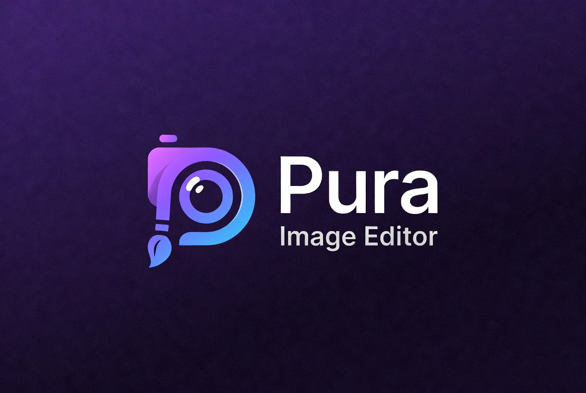

  

# Pura - Image Editor

A powerful, client-side image editor built with vanilla JavaScript and the [cross-image](https://github.com/cross-org/image) library.

## Features

- **Layers**: add, duplicate, reorder (drag & drop), rename, hide, merge down, flatten; per-layer
  opacity, 16 blend modes, thumbnails and frame durations for animation export
- **Tools**: brush & eraser (with live size cursor), fill, linear/radial gradient, rectangle, ellipse,
  line (Shift/Alt constraints, outline or filled), multi-line text, eyedropper, layer picker, move
- **Selections**: rectangular and lasso; painting, fills and filters stay inside the selection;
  move/nudge selected pixels, delete, fill, copy/cut/paste, crop to selection
- **Adjustments & filters** with live preview: brightness, contrast, exposure, saturation, hue,
  box/gaussian blur, median, sharpen, threshold, posterize, pixelate, grayscale, sepia, invert, auto levels
- **Image operations**: canvas resize with anchor, scale image, rotate/flip image or layer, resize layer
- **Files**: open PNG, JPEG, WebP, GIF, APNG, TIFF, BMP, ICO, QOI, PCX, Netpbm, AVIF, HEIC; animated GIF/APNG
  and multi-page TIFF open as layers and can be exported again; drag & drop and clipboard paste
- **Workspaces**: multiple images in tabs, unsaved-change indicators, metadata editor
- **View**: zoom to cursor (Ctrl+wheel), fit to window, space-drag panning, pixel-accurate zoom
- **History**: undo/redo for every action

## Live Demo

Visit [https://puraeditor.com/](https://puraeditor.com/) to try it out!

## Keyboard Shortcuts

Press `?` in the app for the full list. Highlights:

| Keys | Action |
| --- | --- |
| `V` `M` `L` `B` `E` `G` `Shift+G` `U` `O` `N` `T` `I` `A` | Move, select, lasso, brush, eraser, fill, gradient, rectangle, ellipse, line, text, eyedropper, pick layer |
| `[` / `]` | Brush size |
| `X` / `D` | Swap / reset colours |
| `Ctrl+Z`, `Ctrl+Shift+Z` / `Ctrl+Y` | Undo / redo |
| `Ctrl+C` / `X` / `V` | Copy / cut / paste |
| `Ctrl+A` / `Ctrl+D` / `Delete` | Select all / deselect / clear selection |
| `Ctrl+J`, `Ctrl+E`, `Ctrl+Shift+E` | Duplicate layer, merge down, flatten |
| `Ctrl+O`, `Ctrl+Shift+O`, `Ctrl+S` | Open, import as layer, save |
| `Ctrl+0` / `Ctrl+1` / Ctrl+wheel | Fit / actual pixels / zoom |

## Technology

- Pure vanilla JavaScript (ES modules, no build step, no frameworks)
- [@cross/image 0.5.0](https://jsr.io/@cross/image) for decoding, encoding and filters
- HTML5 Canvas for rendering and compositing

See [AGENTS.md](AGENTS.md) for the architecture and contribution guidelines.

## Development

Simply open `index.html` in a modern web browser. No build step required!

## License

MIT